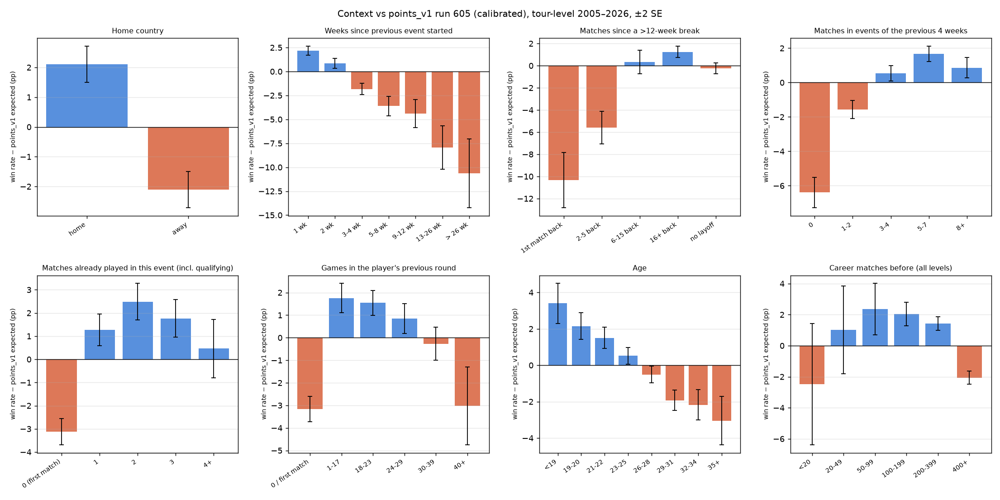

# Context report: what points_v1 misses about a player's situation

2026-11-14. Script: `scripts/context_report.py` (reads only). Numbers: `results/context_report.json`.
Graph: `reports/context_residuals.png`. Host-country map: `data/tournament_country.csv` (hand-made).

## Question

points_v1 (run 605) rates players from points won. It knows surface and best-of (Markov
roll-up), and widens a player's deviation over time, but it knows nothing about the
player's *situation*: playing at home, coming back from a layoff, playing the fourth
week in a row, having just played a 3-hour match. Do players in those situations win more
or less often than points_v1 expects? And is it worth a context layer (milestone 9)?

## Method

- **Baseline:** run 605 replayed from its saved parameters on the current `tennis.db`,
  walk-forward calibrated (`calibrate.py`: per quarter and tour, alpha from the previous
  10 years). Reproduces the documented 0.5968 on the 21,362 tour-level test matches.
- **Scope:** tour-level main-draw matches 2005-01-01 .. 2026-06-02 (the last event with
  stats; after it points_v1 is result-only), 98,791 matches.
- **Features** for each player, point-in-time, from matches at *all* levels (qualifying,
  Challenger, ITF, Davis Cup count as matches played): earlier editions, or earlier rounds
  of the same edition. Sackmann dates matches only by the event's start week, so all gaps
  are event-start to event-start.
- **Residuals (graph, tables 1-3):** per player-match, actual win (0/1) minus calibrated
  points_v1 probability, averaged by the player's bucket. "+2 pp" means players in that
  bucket win 2 percentage points more often than the model said. Rows whose opponent is
  in the same bucket are dropped (their residuals cancel). This part pools 2005-2026, test
  years included: it is descriptive, not a model score.
- **Context model (table 5):** `logit P = logit p_cal + beta . (x_A - x_B)`, antisymmetric
  by construction, ridge-regularised logistic. Fit 2005-18, scored on val 2019-21;
  groups chosen on val; then refit 2005-21 and scored once on test 2022-26.

## Findings

### 1. Rest and layoffs: the biggest and most reliable effect

| situation | rows | resid (pp) | SE | test 2022+ (pp) |
|---|---:|---:|---:|---:|
| 1st match after a >12-week break | 1,200 | **-10.3** | 1.3 | -8.8 |
| 2nd-5th match after the break | 3,653 | **-5.6** | 0.7 | -5.4 |
| 6th-15th match after | 7,168 | +0.3 | 0.5 | +0.3 |
| previous event started 1 week before (back-to-back) | 34,092 | +2.2 | 0.2 | +2.3 |
| ... 2 weeks before | 27,766 | +0.9 | 0.3 | +0.6 |
| ... 3-4 weeks | 20,384 | -1.8 | 0.3 | -1.0 |
| ... 5-8 weeks | 7,433 | -3.6 | 0.5 | -4.2 |
| ... 9-12 weeks | 3,490 | -4.4 | 0.7 | -6.3 |
| ... 13-26 weeks | 1,484 | -8.0 | 1.1 | -4.3 |
| ... > 26 weeks | 583 | -10.6 | 1.8 | -15.1 |
| 0 matches in the previous 4 weeks | 9,459 | **-6.4** | 0.4 | -7.5 |
| 5-7 matches in the previous 4 weeks | 39,864 | +1.7 | 0.2 | +1.8 |

A returning player is rated as if nothing happened. points_v1 widens the *deviation*
during inactivity, but the *mean* stays where it was, and players come back worse: about
10 pp below expectation in their first match, 5-6 pp over the next four, back to normal
after about six matches. The effect is monotone in the gap and holds on test. There is no
sign of fatigue from playing every week: back-to-back weeks are +2 pp, not negative
(partly selection: players who keep playing are healthy and winning).

### 2. Age: ratings lag a player's trajectory

| age | <19 | 19-20 | 21-22 | 23-25 | 26-28 | 29-31 | 32-34 | 35+ |
|---|---:|---:|---:|---:|---:|---:|---:|---:|
| resid (pp) | +3.4 | +2.2 | +1.5 | +0.5 | -0.5 | -1.9 | -2.2 | -3.1 |
| test (pp) | +2.9 | +4.1 | +2.6 | +0.3 | -0.4 | -2.3 | -2.6 | -2.6 |

Young players beat their rating, older players fall short of it, smoothly and on test too.
A random-walk rating has no drift; real players improve until ~25 and decline after ~28.
Career length shows the same thing (400+ prior matches: -2.1 pp, z -9.8).

### 3. In-tournament workload: real patterns, but no out-of-sample gain

| situation | rows | resid (pp) | SE |
|---|---:|---:|---:|
| player's first match of the event, opponent already played here | 24,026 | -3.1 | 0.3 |
| 2 matches already played here | 12,820 | +2.5 | 0.4 |
| previous round 1-17 games (quick win) | 18,566 | +1.8 | 0.3 |
| previous round 40+ games (marathon) | 2,419 | **-3.0** | 0.9 |
| 6 h+ on court already in the event | 4,157 | -1.5 | 0.7 |
| previous round was a walkover or early retirement | 1,796 | -3.1 | 1.1 |

Players who have already won matches at the event (qualifiers, or first-round winners
facing a seed with a bye) outperform the model, which is the same "recent form beats the
rating" pattern as in section 1. A long previous match costs about 3 pp; a free pass
(walkover) also costs 3 pp, so rhythm seems to matter as well as rest. But as a group
these features add nothing on validation (+0.0002 alone; dropping them *improves* val),
because most of the signal is already in recent load and the gap. Not kept.

### 4. Home country: real, but fading

Home players win +2.1 ± 0.3 pp more than expected over 2005-2026 (ATP +2.5, WTA +1.6),
but the effect has shrunk:

| period | 2005-09 | 2010-14 | 2015-19 | 2020-03..2021-06 | 2021-07..23 | 2024-26 |
|---|---:|---:|---:|---:|---:|---:|
| resid (pp) | +2.6 | +3.9 | +1.5 | +1.1 | +0.8 | +0.6 |
| SE | 0.6 | 0.6 | 0.6 | 1.5 | 0.9 | 0.9 |

On validation it adds nothing (+0.0001 ± 0.0003), so it is not in the selected model. A
weight fitted on 2005-18 data would overstate today's home edge. (Wildcards, mostly
given to home players, are probably part of the old effect; not separated here.)

### 5. Match context: points_v1 is underconfident in best-of-5

Calibration slope of the calibrated points_v1 by context (1 = calibrated, > 1 = model
too timid):

| context | n | alpha |
|---|---:|---:|
| best-of-3 | 88,286 | 0.93 ± 0.01 |
| best-of-5 | 10,505 | **1.19 ± 0.02** |
| Grand Slams (level G) | 20,841 | 1.12 ± 0.02 |
| Masters / WTA 1000 (M, PM) | 16,810 | 0.90 / 0.88 |
| retired matches | 2,998 | 0.11 ± 0.03 |

The calibration fits one alpha per tour, so it shrinks best-of-5 predictions that the
Markov roll-up already got about right. A separate best-of-5 slope is cheap and helps
ATP test (-0.0005 extra), though it is small on val (-0.0002). Retirements are close to
coin flips for the model, as expected; they are unknowable before the match and stay in
the scored set.

### 6. A context model on top of points_v1

| model | val 2019-21 | test 2022-26 | test ATP | test WTA | test quarters won |
|---|---:|---:|---:|---:|---:|
| all context groups | -0.0035 ± 0.0008 | -0.0024 ± 0.0005 | -0.0031 | -0.0016 | 14/18 |
| + best-of-5 slope | -0.0036 ± 0.0008 | **-0.0026 ± 0.0005** | -0.0036 | -0.0016 | 15/18 |
| val-selected (rest/layoff, recent load, age, bo5) | -0.0041 ± 0.0007 | -0.0023 ± 0.0005 | -0.0030 | -0.0015 | 13/18 |

Test log loss: **0.5968 -> 0.5942**. That is about a third of points_v1's gain over
Glicko-2 (0.0077), and 10x what any style layer achieved.

Validation ablation (log loss change vs points_v1; "all but" = full model minus the group):

| group | alone | all but |
|---|---:|---:|
| rest / layoff | -0.0023 | -0.0022 |
| recent load (4 weeks) | -0.0014 | -0.0032 |
| age / experience | -0.0013 | -0.0027 |
| best-of-5 slope | -0.0002 | -0.0035 |
| home | +0.0001 | -0.0037 |
| in-event workload | +0.0002 | -0.0040 |

Coefficients (fit 2005-21, logit units per unit of x_A - x_B): first match back -0.34,
matches 2-5 back -0.24, back-to-back week +0.08, 4-week load +0.08 per 5 matches,
age < 21 +0.11, 21-22 +0.07, 32+ -0.08, best-of-5 x logit +0.20, home +0.13.

## What it means

1. **Most of the "context" signal is the rating being stale, not context.** Layoffs,
   recent match load and age all say the same thing: a player's true level moves in
   ways a driftless random walk with a fixed mean doesn't follow. Fixing it in the
   ratings layer may beat a correction on top: drop the serve/return *means* toward a
   lower level after a long break (not only widen the deviation), and add an
   age-dependent drift. Then rerun this report to see what remains.
2. **Build milestone 9 with rest/layoff, recent load, age and a best-of-5 slope.** Skip
   in-tournament workload and home for now; revisit home with a time-varying weight.
3. **Live use needs these features from AcesAPI results**, which is easy: they need
   only match dates, rounds and nationalities, not stats.

## Caveats

- Dates are event start weeks: rest inside a two-week event (Slams, Indian Wells,
  Miami, Madrid, Rome) is not measured, and "weeks since previous event" is coarse.
- Host countries are hand-mapped by tournament name; events whose host changes by year
  (Tour/WTA Finals, Olympics without a city, Laver Cup, Next Gen Finals) are left out.
- Residual tables pool 2005-2026 including test years (descriptive); only section 6 is
  a walk-forward score. Section 6 reported three specs on test; the val-selected one is
  the only one chosen without seeing test, and it lands at -0.0023.
- Selection effects: a player who keeps playing every week is healthy and winning; a
  layoff often means injury. The model doesn't need to separate these to predict, but
  the coefficients aren't causal.

Data: Jeff Sackmann's tennis_atp / tennis_wta (via the Aneeshers archive mirror),
CC BY-NC-SA 4.0.
